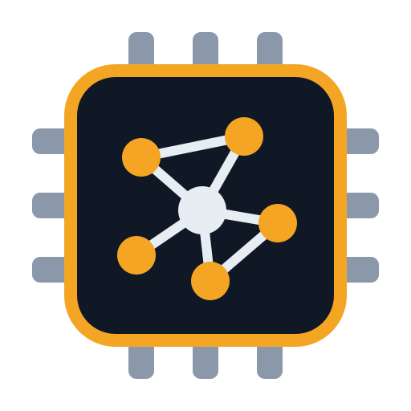

# knn-builder



A remote vector index build service for [OpenSearch k-NN](https://github.com/opensearch-project/k-NN), written in Rust. It is meant as a drop-in replacement for [remote-vector-index-builder](https://github.com/opensearch-project/remote-vector-index-builder): the same HTTP API, the same index files, and the same cuVS CAGRA build on the GPU, with less host memory per build and a GPU that stays busy while vectors download and indexes upload.

**Status:** released. `knn-gpu` builds the CAGRA graph on the GPU with the upstream service's parameters, and `knn-write` writes the index file the service writes, identical to it on every test file; `knn-store` downloads the vectors from S3 and streams the index file back up, with no temporary file; and the library half of `knn-builder` runs the three as a pipeline, the next job downloading while one builds and the last one uploading, within a budget of host memory. The `knn-builder` binary serves the HTTP API on port 1025, answering as the upstream service does, and runs from a container image as the upstream one does; an OpenSearch 3.9.0 node with k-NN's remote index build turned on builds its float, half_float, byte and binary segments through it. `project_link_to_base_layer: true`, an option of the upstream service's next, unreleased version that k-NN does not send yet, is taken as that version takes it: a float, half_float or byte graph whose clusters a search could not leave is linked through an HNSW layer over a sample of its vectors before it is written (`docs/params.md`), which on clustered inputs restores the recall as the upstream service's does (the projection, under Benchmarks). And, an option of knn-builder's own, off by default, each job can check its graph's recall before its index is stored, searching it as k-NN will, and fail when the recall falls below a set least, so that its data node builds the segment itself (Configuration). The service also answers `GET /metrics`, a Prometheus page of its requests, jobs, stage times, forecast and memory, which the upstream service does not have (Metrics).

## Building

The workspace builds on Linux and Windows with the Rust toolchain pinned in `rust-toolchain.toml`:

```sh
cargo build --workspace
cargo test --workspace
```

### GPU build

The cuVS code in `knn-gpu` is behind its `gpu` feature, which builds a small C++ shim over cuVS's C++ API with CMake. It needs Linux (WSL2 works), an NVIDIA GPU, a C++20 compiler (the system g++ will do), and libcuvs with the CUDA runtime and CMake, which the conda environment in `environment.yml` provides at the versions the upstream service uses (libcuvs 26.08.01, CUDA 12.9):

```sh
conda env create -f environment.yml
conda activate knn-builder
cargo test -p knn-gpu --features gpu
```

Under WSL, the first build's CMake step can take minutes while CMake searches the Windows directories WSL appends to `PATH`; leaving them out of `PATH` for the build avoids it.

### Container image

Each release's image is on Docker Hub as `userepo/knn-builder:<version>`, the newest also as `latest`. It runs as the upstream user guide starts the upstream image, on a host with the NVIDIA container toolkit and a driver for CUDA 12.9:

```sh
docker run --gpus all -p 80:1025 userepo/knn-builder:1.4.0
```

The `Dockerfile` builds the service with the `gpu` feature against the conda environment of `environment.yml`, then copies the binary and the CUDA and cuVS libraries it loads onto `nvidia/cuda:12.9.2-base-ubuntu24.04`, the latest patch release of the base the upstream image uses (12.9.0); it runs as its own user, on port 1025. The release workflow builds it from the tag; to build it yourself, with BuildKit, Docker's default builder:

```sh
docker build -t knn-builder .
docker run --gpus all -p 80:1025 knn-builder
```

### Configuration

The service reads the upstream service's environment variables, with the same defaults: `REQUEST_STORE_MAX_SIZE` (10000), `REQUEST_STORE_TTL_SECONDS` (1800, counted from when a job ends, so a running job never expires), `GPU_MEMORY_LIMIT` and `CPU_MEMORY_LIMIT` (24 and 32, in GB; the CPU limit also bounds the host memory of the jobs in flight), `LOG_LEVEL` (`INFO`; `DEBUG` adds each job's stage times and what its projection did), `S3_ENDPOINT_URL` and `AWS_DEFAULT_REGION`, with credentials from the AWS SDK's default chain; a bucket in another region than `AWS_DEFAULT_REGION` is reached through S3's redirect to it, as the upstream service reaches it. `REQUEST_STORE_TYPE` takes only `memory`; `MAX_WORKERS` and `INDEX_SERIALIZATION_MODE` are read and ignored. `BASIC_AUTH_USERNAME` and `BASIC_AUTH_PASSWORD`, set together, turn on Basic Auth: every request but `GET /_heart_beat`, which stays open for health checks, must then carry them.

One more, knn-builder's own, is for the uploads' signatures. Over HTTPS an upload's requests leave its body out of their signature, as the upstream service's do: TLS guards the body on the way and S3 holds each part to its CRC32, where signing it would cost a SHA-256 of the whole file. Over plain HTTP, to `S3_ENDPOINT_URL` or to an endpoint the AWS SDK takes from `AWS_ENDPOINT_URL_S3`, `AWS_ENDPOINT_URL` or the profile, the body is signed. `S3_PAYLOAD_SIGNING_ENABLED` takes what boto3's `payload_signing_enabled` takes and changes that: `true` signs every body, for a bucket whose policy refuses unsigned ones, and `false` signs none, over plain HTTP either.

Three more describe the data nodes that call the service. `CLIENT_TIMEOUT_SECONDS` (3600) and `CLIENT_POLL_INTERVAL_SECONDS` (5) are k-NN's `knn.remote_index_build.client.timeout` and `knn.remote_index_build.poll.interval`, in seconds, and should match the cluster's. `CPU_BUILD_THREADS`, unset by default, is the data node's `knn.algo_param.index_thread_qty`, 1 or 4. The service forecasts when each new job would end, from the jobs ahead of it and what earlier jobs took, and answers 507 at once, rather than take the job, when the GPU's free memory cannot hold its build, when the data node would see it ended only past its timeout, or, with `CPU_BUILD_THREADS` set, when the data node would build the segment sooner itself. k-NN does not retry a 507: the data node builds that segment on its CPU right away, instead of after the timeout. A job whose build no longer fits the GPU's free memory when its turn comes fails at once, for the same reason. And a job the data node has stopped waiting for, its timeout counted from the request, is dropped: one still queued never starts, a transfer stops, and a build under way, which cannot be stopped, stores nothing, so the jobs still waited for move up. Whenever a job ends, the jobs not yet building are forecast again with what it taught, and those that would now miss are dropped at once, so their data nodes build the segments themselves at their next poll.

Three more turn on a recall check, off by default. With `RECALL_CHECK_QUERIES` above 0, each job samples that many of its own vectors as queries (all of them in a smaller job), searches its graph for each one as k-NN will search the file, and compares the results with the exact nearest neighbors; the recall@k, k being `RECALL_CHECK_K` (10), is logged with the job's end. For a file that stores its vectors, it is the recall `knn-inspect recall --sample` reports on that file, with the same count and k and its default seed. A file written with `skip_stored_vectors` holds the graph alone, and k-NN searches it over the quantized vectors Lucene keeps on the data node, which the service never sees: for such a job the check gives the graph's recall over the full vectors instead. The queries being the index's own vectors, the recall reads a little higher than one of held-out queries. The check runs on the CPU beside the write, and the upload waits for it before it completes: 100 queries over 1M vectors of 768 dimensions take about 4 s on 32 threads and 0.1 GB of host memory, and the time grows with the queries (the recall check, under Benchmarks). With `RECALL_CHECK_MIN` set, a recall from 0 to 1, a job below it fails with nothing stored, so its data node builds the segment itself; it needs the check on, and the service does not start with it set and `RECALL_CHECK_QUERIES` at 0.

### Metrics

`GET /metrics` answers the service's metrics in the Prometheus text format (0.0.4) on the API's port, 1025, behind Basic Auth when it is set. It is always on: the counts cost a few additions per request and job, the GPU's memory is read once a second, and the page is built only when something scrapes. k-NN never asks for it, and the upstream service answers it 404. Every label takes a fixed set of values, so the page keeps about 200 series however many jobs and tenants it serves: no bucket, path, tenant or job id leaves the service through it, and `GET /_jobs` stays the per-job view. Every series is on the page from the start at 0, but the requests by route and code, listed as they come, and the memory lines, from their first reading. Counters start again at 0 when the service does, as `process_start_time_seconds` shows.

| Metric | Type | Labels | What it tells |
| --- | --- | --- | --- |
| `knn_builder_build_info` | gauge, 1 | `version` | The running version |
| `knn_builder_http_requests_total` | counter | `route` (build, status, jobs, heart_beat, metrics, other), `code` | Requests answered |
| `knn_builder_build_requests_total` | counter | `result` (accepted, held, invalid, conflict, store_full, too_large, late, cpu_sooner) | `POST /_build` by answer: a new job, a retry of a job held, a body refused, the 409, and each 507 |
| `knn_builder_jobs_in_flight` | gauge | `stage` (queued, downloading, loaded, building, graphed, uploading) | Jobs that have not ended, by pipeline stage |
| `knn_builder_jobs_held`, `knn_builder_jobs_held_limit` | gauge | | Jobs in the store, running or ended within the TTL, and `REQUEST_STORE_MAX_SIZE` |
| `knn_builder_jobs_ended_total` | counter | `outcome` (completed, download_failed, host_memory, bad_parameters, device_memory, build_failed, write_failed, upload_failed, low_recall, forecast_late, timed_out, canceled, panicked) | Jobs by how they ended, each once; `forecast_late` and `timed_out` are the drops of Configuration |
| `knn_builder_vectors_built_total` | counter | `data_type` | Vectors in the indexes stored |
| `knn_builder_job_seconds` | histogram | | From the request to the end, for completed jobs: what the data node waits, less its poll |
| `knn_builder_queue_seconds` | histogram | | From the request until the job's download starts, for completed jobs |
| `knn_builder_stage_seconds` | histogram | `stage` (download, build, projection, recall_check, upload) | Each stage's time, for completed jobs: the `DEBUG` stage-times line's |
| `knn_builder_forecast_ratio` | histogram | | Seconds a completed job took over the seconds forecast when it was taken; above 1, slower |
| `knn_builder_stage_model_ratio` | gauge | `stage` | The forecast's learned correction, observed over modeled seconds; far from 1, this host, its S3 or its load differs from those the model was fitted on |
| `knn_builder_drain_seconds` | gauge | | Forecast seconds until the last job in flight ends; 0 when idle |
| `knn_builder_recall` | histogram | | The recall check's recall, for completed jobs and those failed for it |
| `knn_builder_host_budget_bytes`, `knn_builder_host_budget_used_bytes` | gauge | | `CPU_MEMORY_LIMIT` as the pipeline counts it, and the buffers of the jobs in flight |
| `process_resident_memory_bytes` | gauge | | The service's resident memory (`VmRSS`); Linux only |
| `process_start_time_seconds` | gauge | | When the service started, in Unix seconds |
| `knn_builder_gpu_memory_total_bytes`, `knn_builder_gpu_memory_free_bytes` | gauge | | The GPU's memory and its free memory, every process on it counted, read once a second; the three GPU lines are left off the page once reads have failed for 5 s |
| `knn_builder_gpu_memory_last_build_peak_bytes` | gauge | | The most GPU memory in use during the last build that ended, read every 50 ms during a build |

Times are in seconds, sizes in bytes. The seconds histograms' buckets run from 0.1 to 2,500, the ratio's from 0.5 to 4 and the recall's from 0.5 to 1.

The two request counters count differently. `build_requests_total` counts the requests that reach the service's parser; `http_requests_total{route="build"}` counts every answer, the 401s, 405s and 413s that never get there among them. The GPU's peak counts every process on the device and what is in use at idle (1.2 GB under WSL2 on the benchmark laptop, 0.13 to 0.17 GB of it the service's own CUDA context and cuVS's), so read it against the free memory of an idle service; a peak shorter than 50 ms can be missed.

On the benchmark laptop a scrape of a full store, 10,000 jobs held with 1,000 of them in flight, took under half a millisecond, and the reads of the GPU's memory left the build times within their run-to-run spread. A Prometheus scrape config, with the service's Basic Auth when it is set:

```yaml
scrape_configs:
  - job_name: knn-builder
    scrape_interval: 15s
    basic_auth:
      username: admin
      password_file: /etc/prometheus/knn-builder-password
    static_configs:
      - targets: ["knn-builder:1025"]
```

Five queries to start from:

```promql
# Share of build requests refused: the data nodes build those segments themselves.
sum(rate(knn_builder_build_requests_total{result=~"store_full|too_large|late|cpu_sooner"}[5m]))
  / sum(rate(knn_builder_build_requests_total[5m]))

# Forecast time to drain over CLIENT_TIMEOUT_SECONDS (3600 here): near 1, new jobs are refused as late.
knn_builder_drain_seconds / 3600

# Median of the time completed jobs took over the time forecast.
histogram_quantile(0.5, sum by (le) (rate(knn_builder_forecast_ratio_bucket[1h])))

# Share of the jobs checked whose recall was 0.95 or less.
sum(rate(knn_builder_recall_bucket{le="0.95"}[1h])) / sum(rate(knn_builder_recall_count[1h]))

# Share of the job store taken: at 1, new jobs are refused as store_full.
knn_builder_jobs_held / knn_builder_jobs_held_limit
```

### S3 tests

The tests of `knn-store` and `knn-builder` that need S3 are ignored by default. CI runs them against LocalStack 4.14, pinned by digest as in `tools/README.md`; locally, start the same image and point the service's own environment variables at it:

```sh
docker run -d --rm --name knn-store-localstack -p 4566:4566 localstack/localstack@sha256:3ebc37595918b8accb852f8048fef2aff047d465167edd655528065b07bc364a
S3_ENDPOINT_URL=http://localhost:4566 AWS_DEFAULT_REGION=us-east-1 AWS_ACCESS_KEY_ID=test AWS_SECRET_ACCESS_KEY=test cargo test -p knn-store -p knn-builder -- --ignored
```

Each test creates a bucket of its own and removes it when it passes.

## Benchmarks

Both services, measured the same way on the same machine over the datasets the upstream `benchmarking/` tool names, 1M vectors each: sift-128, ms-marco-384, cohere-768 and gist-960, as float inputs in L2 and inner product, the first three also as byte inputs (each component scaled over the dataset's range onto -128..127) and as binary inputs in Hamming space (a bit per positive component). The services ran from their container images under Docker Desktop on WSL2 with LocalStack for S3, `GPU_MEMORY_LIMIT=8`, on an NVIDIA GeForce RTX 4070 Laptop GPU (8 GB), an Intel Core i9-14900HX and 32 GB of memory, 15 GB of it the Docker VM's: knn-builder with libcuvs 26.08.01 and CUDA 12.9, the upstream service as its `api-snapshot` image (libcuvs 26.08.01, Faiss 1.14.3, the same CUDA) on `MAX_WORKERS=1`, since two builds at once crashed it under WSL2; knn-builder builds one job on the GPU while the next downloads and the last uploads. Every number is the median of five builds, or counted over five rounds, except the bursts and the hour-long queues, run once. The last subsection, On EC2 with S3, repeats the benchmark on two cloud hosts against S3, with the upstream service on two workers.

The tables hold two rounds of runs. The single builds of the float and byte inputs are the later one: knn-builder at commit 3a4eb45 and the upstream image at digest `e8fecaef…` (commit ea7db9f), on driver 621.24. The binary tables and every row of concurrent, burst and sustained jobs are the earlier one: knn-builder at commit d4af6b8 and the upstream image at digest `78ced9d0…` (commit 3a02e64), on driver 617.42. Between the two, both services came to build float, half_float and byte graphs from the vectors in host memory instead of a copy of them on the GPU, the upstream service at ea7db9f, which knn-builder follows. A float or byte build's device peak fell by up to the size of its vectors (cohere-768 as float, 3.07 GB of them, peaked at 3.70 and 3.74 GB in the earlier round and peaks at 0.82 and 0.87 GB), so those single builds were run again. Binary graphs build as they did, and the jobs under load were not run again: their rows are of the earlier build.

The metrics, per data type in the tables below:

- **Latency** is a build of the input alone, from the request to the status that shows it completed, asked every 0.2 s. **Steps** is the same job on the service's own clock, the sum of its steps, which its `DEBUG` log gives: **Download**, **Build** (for the upstream service, its build, conversion and write together) and **Upload**. The services split the last two differently: the upstream service writes the index to a local file, counted in its Build, and then uploads that file, while knn-builder writes the index straight into the upload, so its Upload is the write and the transfer together. The steps do not line up exactly beyond that: knn-builder lays out the file's HNSW levels as it writes, which the upstream service does in its conversion. Latency and Steps differ where the client saw the completed status late: 18 to 31 s after the service logged the job's end on 5 of knn-builder's 85 builds, with no status request reaching the service in between, and 1 to 26 s after the last step on 16 of the upstream's, all of float files of 1.8 GB or more; on every other build the two are within 0.3 s (knn-builder) and 0.6 s (upstream). Those waits, between the client and the container on this host (the requests pass through Docker Desktop's port forwarding), are in the latencies and not in the steps.
- **Host peak** is the service process's peak resident memory over the job (`VmHWM`, reset before it), **Device peak** the GPU's memory at its peak during the job, sampled every 50 ms, less the level the samples last stayed at before it, since `nvidia-smi` under WSL2 reads no memory used once the GPU has idled for about ten seconds. The earlier round's runs, first measured against the least seen, are recomputed from their samples: 0.14 to 0.18 GB lower where the GPU had idled.
- **Recall@10** is the first build's index searched for the dataset's first 100 test queries with [knn-inspect](https://github.com/userepo/knn-inspect) 0.17.0, against the exact neighbors; the GPU build is not deterministic, so another build's recall differs in its last digits.
- **Concurrent**: five rounds of eight requests sent at once, as k-NN's data nodes send them (one retry after a second of a 408, 409, 429, 500, 502, 503 or 509, a first status request after three poll intervals of 5 s and one an interval after), over the data type's inputs in turn; the latency each data node saw, its p50 and p99 over the 40 jobs.
- **Burst**: 48 requests at once over the data type's L2 inputs (Hamming for binary), the service restarted and warmed up before each, with the data nodes' timeout set to 90 s and the services told so (`CLIENT_TIMEOUT_SECONDS`): how many were built in time, refused at once (a 507, after which the data node builds the segment itself), failed (knn-builder drops a job it forecasts to miss the timeout as the jobs before it end, so the data node starts its own build at the next poll instead of after the timeout) or timed out; **CPU wait** is the seconds the 48 data nodes waited in all before building on their own CPUs.
- **Sustained**: four jobs kept in flight for an hour over the data type's inputs in turn, the next sent as one completes; **Jobs per hour** counts the jobs seen completed within the hour.

### binary

| Input | Service | Builds | Latency s | Steps s | Download s | Build s | Upload s | Host peak GB | Device peak GB | Recall@10 |
| --- | --- | --- | --- | --- | --- | --- | --- | --- | --- | --- |
| `cohere-hamming-1000000x768-binary` | knn-builder | 5 | 23.8 | 23.5 | 0.2 | 22.7 | 0.7 | 3.06 | 0.49 | 0.963 |
| `cohere-hamming-1000000x768-binary` | upstream | 5 | 25.1 | 24.9 | 0.2 | 23.8 | 0.8 | 2.98 | 0.62 | 0.966 |
| `ms-marco-hamming-1000000x384-binary` | knn-builder | 5 | 16.8 | 16.7 | 0.1 | 16.0 | 0.6 | 2.94 | 0.44 | 0.989 |
| `ms-marco-hamming-1000000x384-binary` | upstream | 5 | 18.2 | 18.1 | 0.2 | 17.4 | 0.6 | 2.78 | 0.57 | 0.988 |
| `sift-hamming-1000000x128-binary` | knn-builder | 5 | 11.4 | 11.3 | 0.1 | 10.7 | 0.5 | 2.89 | 0.41 | 1.000 |
| `sift-hamming-1000000x128-binary` | upstream | 5 | 12.9 | 12.7 | 0.3 | 12.0 | 0.4 | 2.83 | 0.54 | 1.000 |

| Service | Concurrent jobs | Built | Latency p50 s | p99 s | Burst | CPU wait s | Sustained | Jobs per hour |
| --- | --- | --- | --- | --- | --- | --- | --- | --- |
| knn-builder | 8 x 5 | 40 of 40 | 76.4 | 135.1 | 48: 4 built, 44 refused, 0 failed, 0 timed out | 1.4 | 4 in flight for 3600 s | 228.0 |
| upstream | 8 x 5 | 40 of 40 | 72.7 | 156.6 | 48: 3 built, 0 refused, 0 failed, 45 timed out | 4181.9 | 4 in flight for 3600 s | 201.0 |

### byte

| Input | Service | Builds | Latency s | Steps s | Download s | Build s | Upload s | Host peak GB | Device peak GB | Recall@10 |
| --- | --- | --- | --- | --- | --- | --- | --- | --- | --- | --- |
| `cohere-ip-1000000x768-byte` | knn-builder | 5 | 20.1 | 20.0 | 2.0 | 15.0 | 2.0 | 1.58 | 0.67 | 0.950 |
| `cohere-ip-1000000x768-byte` | upstream | 5 | 23.6 | 23.4 | 1.9 | 17.6 | 3.8 | 3.23 | 0.72 | 0.959 |
| `cohere-l2-1000000x768-byte` | knn-builder | 5 | 19.7 | 19.6 | 2.0 | 15.2 | 2.2 | 1.58 | 0.67 | 0.961 |
| `cohere-l2-1000000x768-byte` | upstream | 5 | 23.3 | 23.2 | 1.9 | 17.8 | 3.2 | 3.14 | 0.72 | 0.962 |
| `ms-marco-ip-1000000x384-byte` | knn-builder | 5 | 11.1 | 11.0 | 1.0 | 8.7 | 1.3 | 1.19 | 0.40 | 0.981 |
| `ms-marco-ip-1000000x384-byte` | upstream | 5 | 14.6 | 14.4 | 1.1 | 10.3 | 3.0 | 2.33 | 0.57 | 0.983 |
| `ms-marco-l2-1000000x384-byte` | knn-builder | 5 | 11.3 | 11.1 | 1.1 | 8.7 | 1.3 | 1.19 | 0.40 | 0.985 |
| `ms-marco-l2-1000000x384-byte` | upstream | 5 | 13.8 | 13.7 | 1.0 | 10.3 | 2.2 | 2.35 | 0.57 | 0.980 |
| `sift-ip-1000000x128-byte` | knn-builder | 5 | 5.3 | 5.1 | 0.3 | 4.0 | 0.8 | 0.93 | 0.40 | 0.672 |
| `sift-ip-1000000x128-byte` | upstream | 5 | 6.0 | 5.9 | 0.4 | 4.7 | 0.8 | 1.86 | 0.57 | 0.721 |
| `sift-l2-1000000x128-byte` | knn-builder | 5 | 5.3 | 5.3 | 0.3 | 4.1 | 0.8 | 0.93 | 0.40 | 0.998 |
| `sift-l2-1000000x128-byte` | upstream | 5 | 5.9 | 5.7 | 0.4 | 4.5 | 0.8 | 1.87 | 0.57 | 0.994 |

| Service | Concurrent jobs | Built | Latency p50 s | p99 s | Burst | CPU wait s | Sustained | Jobs per hour |
| --- | --- | --- | --- | --- | --- | --- | --- | --- |
| knn-builder | 8 x 5 | 40 of 40 | 58.6 | 97.5 | 48: 11 built, 36 refused, 1 failed, 0 timed out | 15.4 | 4 in flight for 3600 s | 399.0 |
| upstream | 8 x 5 | 40 of 40 | 70.8 | 159.2 | 48: 4 built, 0 refused, 0 failed, 44 timed out | 4085.6 | 4 in flight for 3600 s | 270.0 |

### float

| Input | Service | Builds | Latency s | Steps s | Download s | Build s | Upload s | Host peak GB | Device peak GB | Recall@10 |
| --- | --- | --- | --- | --- | --- | --- | --- | --- | --- | --- |
| `cohere-ip-1000000x768` | knn-builder | 5 | 33.6 | 30.4 | 8.4 | 15.2 | 7.2 | 3.88 | 0.82 | 0.955 |
| `cohere-ip-1000000x768` | upstream | 5 | 74.0 | 63.2 | 7.5 | 18.1 | 37.7 | 7.83 | 0.87 | 0.945 |
| `cohere-l2-1000000x768` | knn-builder | 5 | 32.7 | 32.5 | 8.2 | 15.6 | 7.6 | 3.88 | 0.82 | 0.964 |
| `cohere-l2-1000000x768` | upstream | 5 | 69.7 | 69.1 | 7.5 | 19.2 | 42.4 | 7.75 | 0.87 | 0.941 |
| `gist-ip-1000000x960` | knn-builder | 5 | 59.1 | 40.8 | 10.4 | 20.0 | 10.2 | 4.65 | 1.02 | 0.961 |
| `gist-ip-1000000x960` | upstream | 5 | 92.8 | 82.6 | 9.3 | 21.6 | 51.8 | 9.29 | 1.07 | 0.998 |
| `gist-l2-1000000x960` | knn-builder | 5 | 47.5 | 44.3 | 10.2 | 22.1 | 11.0 | 4.65 | 1.02 | 0.951 |
| `gist-l2-1000000x960` | upstream | 5 | 90.5 | 86.5 | 9.0 | 22.6 | 55.0 | 9.20 | 1.07 | 0.948 |
| `ms-marco-ip-1000000x384` | knn-builder | 5 | 18.9 | 18.8 | 4.0 | 10.5 | 4.1 | 2.34 | 0.42 | 0.980 |
| `ms-marco-ip-1000000x384` | upstream | 5 | 39.8 | 32.4 | 3.8 | 11.8 | 16.9 | 4.62 | 0.57 | 0.980 |
| `ms-marco-l2-1000000x384` | knn-builder | 5 | 18.0 | 17.7 | 4.0 | 9.5 | 4.3 | 2.34 | 0.42 | 0.964 |
| `ms-marco-l2-1000000x384` | upstream | 5 | 33.8 | 31.2 | 3.8 | 10.7 | 16.9 | 4.64 | 0.57 | 0.978 |
| `sift-ip-1000000x128` | knn-builder | 5 | 7.4 | 7.3 | 1.4 | 4.2 | 1.8 | 1.32 | 0.40 | 0.991 |
| `sift-ip-1000000x128` | upstream | 5 | 8.8 | 8.6 | 1.3 | 5.0 | 2.4 | 2.61 | 0.57 | 0.990 |
| `sift-l2-1000000x128` | knn-builder | 5 | 7.4 | 7.2 | 1.3 | 4.1 | 1.8 | 1.32 | 0.40 | 0.997 |
| `sift-l2-1000000x128` | upstream | 5 | 8.5 | 8.3 | 1.3 | 5.0 | 2.0 | 2.63 | 0.57 | 0.998 |

| Service | Concurrent jobs | Built | Latency p50 s | p99 s | Burst | CPU wait s | Sustained | Jobs per hour |
| --- | --- | --- | --- | --- | --- | --- | --- | --- |
| knn-builder | 8 x 5 | 40 of 40 | 162.1 | 314.6 | 48: 2 built, 42 refused, 3 failed, 1 timed out | 228.4 | 4 in flight for 3600 s | 104.0 |
| upstream | 8 x 5 | 40 of 40 | 318.6 | 714.4 | 48: 0 built, 0 refused, 0 failed, 48 timed out | 4438.6 | 4 in flight for 3600 s | 45.0 |

Reading across the tables: knn-builder's build step is 2 to 18% shorter than the upstream service's (the least on gist-960 in L2, the most on cohere-768 in L2), and without the upstream's write, 0.1 to 2.4 s of its step, between 4% longer on gist-960 in L2 and 14% shorter, its upload of a float index of 1.5 GB or more, streamed as the file is written, 18 to 25% of the upstream's at the median, and 17 to 24% of its write and upload together (on this host one file's five uploads differ by 1.6 to 3.7 times between the fastest and the slowest, for both services), and its host memory half the upstream's on float and byte inputs (3.88 GB against 7.75 and 7.83 for cohere-768, 4.65 against 9.20 and 9.29 for gist-960), and the same on binary, where it is 0.1 GB higher; its device peaks are 0.05 GB lower on cohere-768 and gist-960 as float and byte inputs, and 0.13 to 0.17 GB lower on the rest. Under load, as the earlier round measured it, it completes more jobs an hour (104 against 45 on float, 399 against 270 on byte, 228 against 201 on binary) with a lower p99 (the binary p50 is 4 s higher), and in a burst it refuses at once what it cannot build in time, so the 48 data nodes wait at most a few minutes in all rather than the whole timeout each. The recalls, each of one build over 100 queries, match within 0.025, except gist-960 in inner product (0.961 against 0.998) and SIFT's byte input in inner product, where both are low (0.67 and 0.72): scaling SIFT's counts onto -128..127 shifts every component, and the inner product then ranks mostly by the shift. Gist's gap is that build's and not the service's. Under inner product its queries share their neighbors, 54 vectors filling all 1,000 places, the most common of them three times the median vector's length, so a build that leaves one of them hard to reach at `ef_search` 100 loses it for dozens of queries at once: 37 of the 100 miss one neighbor each in that file. Five more builds by each service recall 0.973 to 0.999 (knn-builder) and 0.960 to 0.997 (upstream), the upstream's lowest two missing the same way, and every one 0.989 or more at `ef_search` 400 (`fixtures/ea7db9f/bench-single/gist-ip.json`).

The runs' records are in `fixtures/bench/` (the earlier round: `run.json` and `recall.json` per service, `datasets.json`, and `environment.json` with the versions) and `fixtures/ea7db9f/bench-single/` (the later one, the same files but for the datasets), and `tools/bench/` reproduces them: `datasets.py` fetches the datasets and writes the inputs, `run.py` runs one service through the phases, or through those named over the inputs named (`--phases single` and the float and byte inputs' names for the later round), and `report.py` prints a round's tables from its run directories. From the repository root, with Docker, `nvidia-smi` and Python on the host, as `tools/README.md` describes in full:

```sh
python tools/bench/datasets.py ~/knn-bench/hdf5 target/bench/inputs
docker build -t knn-builder:dev .
python tools/bench/run.py target/bench/knn-builder knn-builder
python tools/bench/run.py target/bench/upstream upstream
python tools/bench/report.py ../knn-inspect/target/release/knn-inspect target/bench/knn-builder target/bench/upstream
```

### The projection

`project_link_to_base_layer` is for vectors in clusters so far apart that the CAGRA build links none of them to another, so a search never leaves the clusters its entry points fall in ([issue 158](https://github.com/opensearch-project/remote-vector-index-builder/issues/158) of the upstream service). Both services built six such inputs without it and with it, five builds each: Gaussian mixtures of 300,000 unit vectors of dimension 256 under inner product, in 200 clusters at sigma 0.3 (as a float, a half_float and a byte field) and at sigma 1.0, in 1,000 clusters at sigma 0.3, and, as a control whose graph builds connected, in 200 overlapping clusters at sigma 2.0. They ran as the builds above on the same machine (driver 621.24), knn-builder at commit 3a4eb45, which keeps layer 1's threads from one batch to the next, and the upstream service as its `api-snapshot` image at digest `e8fecaef…` (commit ea7db9f). A cell holds the mean of the five builds without the projection, then with it:

- **Components** counts the strongly connected components of the file's level 0: 1 where a search can get from any node to any other.
- **Recall@10** and **Recall@100** are knn-inspect's over 1,000 held-out queries, each the mean over five seeds of its random entry points: at 10 with the file's own settings (`ef_search` 100, 32 entry points), as k-NN searches it by default, and at 100 with `ef_search` 600 from 32 entry points.
- **Projection s** is the projection's time in the service's `DEBUG` log, in the builds that asked for it; **Latency** and **Host peak** are as above.

| Input | Service | Components | Recall@10 | Recall@100 | Projection s | Latency s | Host peak GB |
| --- | --- | --- | --- | --- | --- | --- | --- |
| `ip-300000x256-c200-s0.3` | knn-builder | 200 to 1 | 0.147 to 0.950 | 0.150 to 0.999 | 0.27 | 4.54 to 4.92 | 1.36 to 1.32 |
| `ip-300000x256-c200-s0.3` | upstream | 200 to 1 | 0.147 to 0.949 | 0.150 to 0.999 | 0.21 | 5.20 to 5.43 | 2.07 to 2.12 |
| `ip-300000x256-c200-s0.3-fp16` | knn-builder | 200 to 1 | 0.147 to 0.951 | 0.150 to 0.999 | 0.27 | 3.87 to 4.13 | 1.21 to 1.17 |
| `ip-300000x256-c200-s0.3-fp16` | upstream | 200 to 1 | 0.147 to 0.949 | 0.150 to 0.999 | 0.21 | 4.07 to 4.37 | 1.78 to 1.84 |
| `ip-300000x256-c200-s0.3-byte` | knn-builder | 200 to 1 | 0.147 to 0.950 | 0.150 to 0.999 | 0.26 | 3.50 to 3.74 | 1.13 to 1.06 |
| `ip-300000x256-c200-s0.3-byte` | upstream | 200 to 1 | 0.146 to 0.951 | 0.150 to 0.999 | 0.22 | 3.66 to 4.05 | 1.63 to 1.68 |
| `ip-300000x256-c200-s1.0` | knn-builder | 200 to 1 | 0.144 to 0.938 | 0.144 to 1.000 | 0.34 | 4.47 to 4.75 | 1.36 to 1.33 |
| `ip-300000x256-c200-s1.0` | upstream | 200 to 1 | 0.144 to 0.934 | 0.144 to 1.000 | 0.25 | 5.05 to 5.38 | 2.09 to 2.14 |
| `ip-300000x256-c1000-s0.3` | knn-builder | 998 to 1 | 0.033 to 0.936 | 0.033 to 1.000 | 0.34 | 4.61 to 4.97 | 1.37 to 1.32 |
| `ip-300000x256-c1000-s0.3` | upstream | 998 to 1 | 0.033 to 0.935 | 0.033 to 1.000 | 0.26 | 5.12 to 5.46 | 2.07 to 2.11 |
| `ip-300000x256-c200-s2.0` | knn-builder | 1 to 1 | 0.669 to 0.670 | 0.970 to 0.970 | 0.05 | 4.61 to 4.66 | 1.36 to 1.33 |
| `ip-300000x256-c200-s2.0` | upstream | 1 to 1 | 0.677 to 0.671 | 0.969 to 0.969 | 0.26 | 5.03 to 5.33 | 2.09 to 2.13 |

Without the projection both services' graphs fall apart into a component a cluster, and a search finds only the neighbors in the clusters it entered: a recall of 0.14 to 0.15 for 200 clusters and 0.03 for 1,000, at 10 and at 100 alike. With it every such graph is one component on both services, recalling 0.9985 or more at 100 and 0.93 to 0.95 at 10. Both leave the control as built, its graph being connected already: the option goes by what a search can reach, not by what it finds, and the control's recall stays where it was, 0.97 at 100 and 0.67 at 10, below the projected graphs'.

knn-builder's projection is the upstream service's but for the order layer 1's nodes go in (`docs/params.md`). The two promote the same 18,831 nodes, and knn-builder adds 0.2 to 0.7% more links. Its mean recall@10 is within the range of the upstream service's five builds on three of the five split inputs and above it on two, the half_float copy (0.951 against 0.949 at the mean) and 200 clusters at sigma 1.0 (0.938 against 0.934, its builds recalling 0.936 to 0.940 and the upstream's 0.931 to 0.937); at 100 the two are within 0.0003 on every split input, and 0.0008 apart on the control, which neither changes. Its projection takes 0.26 to 0.34 s against 0.21 to 0.26 s, layer 1 being 0.21 to 0.27 s of it against 0.13 to 0.18 s; on the control, where each only measures what a search reaches, it takes 0.05 s against 0.26 s. With the projection knn-builder's builds still end sooner (3.74 to 4.97 s against 4.05 to 5.46 s) and in less host memory (1.06 to 1.33 GB against 1.68 to 2.14 GB). Its host peaks with the projection and without are within 0.07 GB of each other, as far as the same builds' peaks lie apart from one run to the next, so the lower figures with it in the table are no saving; neither service's device peak changes (0.21 to 0.22 GB and 0.26 to 0.27 GB).

The records are in `fixtures/ea7db9f/projection/`, with every build's figures and their ranges in its `summary.md`. `tools/README.md` gives the commands: `make_inputs.py clustered` writes the inputs, `run.py --project` asks for the projection, and `projection.py` scores the files.

### The recall check

The recall check is knn-builder's alone, so it was measured against knn-builder without it: six 1M inputs built five times each with the check off, then five times at `RECALL_CHECK_QUERIES=100` and the default k of 10. The inputs are cohere-768 in L2 as a float field, as a half_float request of its fp32 vectors, as byte, as binary in Hamming space and as a float request with `skip_stored_vectors`, and gist-960 in L2 as float. The service was the image of commit 98de150 on the same machine as above (driver 621.24). Each cell holds the median of five builds:

- **Steps** and **Upload** are as above. The check runs beside the upload, which waits for it before it completes.
- **Check s** is the check's own time in the service's `DEBUG` log.
- **Host peak** is as above. **Added** is the median growth from each round's build without the check to that round's build with it. The peaks of both runs fell by about 0.15 GB from one round to the next, so the rounds are compared pairwise rather than as medians.
- **Recall** is the check's recall@10.

| Input | Data type | Steps s | with the check | Upload s | with the check | Check s | Host peak GB | with the check | Added GB | Recall |
| --- | --- | --- | --- | --- | --- | --- | --- | --- | --- | --- |
| `cohere-l2-1000000x768` | float | 32.5 | 36.4 | 7.4 | 11.5 | 3.8 | 4.17 | 4.26 | 0.10 | 0.987 |
| `cohere-l2-1000000x768-fp16from32` | half_float | 28.1 | 30.6 | 3.8 | 6.1 | 3.7 | 2.63 | 2.74 | 0.11 | 0.986 |
| `cohere-l2-1000000x768-byte` | byte | 20.9 | 23.6 | 2.4 | 5.2 | 3.6 | 1.86 | 1.96 | 0.09 | 0.991 |
| `cohere-hamming-1000000x768-binary` | binary | 25.1 | 25.8 | 0.7 | 0.9 | 0.4 | 2.88 | 2.98 | 0.10 | 1.000 |
| `cohere-l2-1000000x768-skip` | float, `skip_stored_vectors` | 25.9 | 29.0 | 0.5 | 3.6 | 3.5 | 4.17 | 4.26 | 0.09 | 0.985 |
| `gist-l2-1000000x960` | float | 54.4 | 58.4 | 21.0 | 26.2 | 4.9 | 4.90 | 5.00 | 0.10 | 0.957 |

The two runs compare with each other, not with the tables above. Their builds of cohere-768 took 7 to 10% longer than those (17.1 s against 15.6 s as float), with the check and without alike, and gist-960's the same time; the same image had built cohere-768 as float in 15.0 s two hours earlier, so the difference is the machine's state after hours of builds, not the service's. Their host peaks start higher and fall round by round, to 3.79 GB for cohere-768 as float in the last round without the check against the float table's 3.88 GB, as the peaks of the first benchmark's runs fell, which also had binary inputs among the others; the float and byte runs alone held theirs within 0.1 GB after the first round. And gist-960's uploads to LocalStack took twice as long as in the float table.

At 100 queries the check takes 3.5 to 3.8 s over cohere-768's vectors, 4.9 s over gist-960's and 0.4 s over binary ones. The service counts about 0.13 GB of host memory for it, nearly all of it the table of nodes seen that each of the 32 searching threads keeps, 4 bytes a vector; the jobs' host peaks grew by 0.09 to 0.11 GB.

The check runs beside the upload, but on this machine it added most of its own time to the job. The cohere-768 uploads grew by 2.3 to 4.1 s, the float one's by more than its 3.8 s check, so the write made little headway while the check ran. The check's 32 threads take the whole processor, which the write and LocalStack, receiving the upload, share here; which of the two was held back was not measured. A `skip_stored_vectors` file is the graph alone and uploads in half a second, so that job waits for nearly the whole check. gist-960's uploads ranged from 18 to 34 s from one build to the next, too widely to show what the check added. Over the jobs' steps, the check added 3 to 13%, the most on the byte job, the shortest of the six.

The recalls read higher than the Recall@10 in the float, byte and binary tables (0.987 against 0.964 for cohere-768 as float), since the check's queries are the index's own vectors. `fixtures/ea7db9f/recall-parity/` shows, on other builds of these inputs, that the check's recall equals knn-inspect's `recall --sample` on a file that stores its vectors; `fixtures/ea7db9f/recall-cost/` holds these runs.

### On EC2 with S3

The same benchmark on two cloud hosts, on Linux without WSL2 and against S3 itself: an EC2 g4dn.2xlarge with a Tesla T4, then a g5.2xlarge with a faster GPU, an NVIDIA A10G. On both:

- **Software:** Ubuntu 24.04, driver 595.91.07 and Docker 29.7.2.
- **S3:** a bucket in the instance's region, us-east-2, reached through the instance's role.
- **Services:** knn-builder's 1.4.0 image and the upstream image of the laptop's later round (digest `e8fecaef…`, commit ea7db9f), with `GPU_MEMORY_LIMIT` set to the GPU's memory. The upstream service ran on its default `MAX_WORKERS=2` through every phase without the crash it has under WSL2.
- **Method:** the inputs and metrics of the laptop's tables, with five builds of each input and five rounds of eight concurrent jobs. Recall is by knn-inspect 0.18.0.

#### g4dn.2xlarge (Tesla T4)

- **Host:** an NVIDIA Tesla T4 (16 GB), 8 vCPUs of an Intel Xeon Platinum 8259CL and 32 GB of memory.
- **Phases:** single builds, concurrent rounds, and four jobs in flight for an hour.
- **Timing:** the upstream service's single builds ran a day before knn-builder's, on the same instance, which was not stopped in between.
- **No burst:** a burst job has 90 s, and on this host one build of cohere-768 in L2 (as float or as byte) or of gist-960 in L2 takes longer than that on either service.

**binary**

| Input | Service | Builds | Latency s | Steps s | Download s | Build s | Upload s | Host peak GB | Device peak GB | Recall@10 |
| --- | --- | --- | --- | --- | --- | --- | --- | --- | --- | --- |
| `cohere-hamming-1000000x768-binary` | knn-builder | 5 | 74.1 | 74.0 | 0.3 | 72.7 | 1.0 | 3.13 | 0.49 | 0.967 |
| `cohere-hamming-1000000x768-binary` | upstream | 5 | 83.8 | 83.6 | 0.8 | 82.1 | 0.8 | 3.61 | 0.62 | 0.966 |
| `ms-marco-hamming-1000000x384-binary` | knn-builder | 5 | 43.9 | 43.9 | 0.2 | 42.8 | 0.9 | 3.09 | 0.44 | 0.988 |
| `ms-marco-hamming-1000000x384-binary` | upstream | 5 | 53.8 | 53.7 | 0.8 | 52.0 | 0.8 | 3.58 | 0.57 | 0.988 |
| `sift-hamming-1000000x128-binary` | knn-builder | 5 | 32.1 | 31.9 | 0.2 | 30.8 | 0.8 | 3.05 | 0.41 | 1.000 |
| `sift-hamming-1000000x128-binary` | upstream | 5 | 41.5 | 41.4 | 0.4 | 40.3 | 0.7 | 3.55 | 0.54 | 1.000 |

| Service | Concurrent jobs | Built | Latency p50 s | p99 s | Sustained | Jobs per hour |
| --- | --- | --- | --- | --- | --- | --- |
| knn-builder | 8 x 5 | 40 of 40 | 236.8 | 414.0 | 4 in flight for 3600 s | 73.0 |
| upstream | 8 x 5 | 40 of 40 | 225.9 | 387.7 | 4 in flight for 3600 s | 78.0 |

**byte**

| Input | Service | Builds | Latency s | Steps s | Download s | Build s | Upload s | Host peak GB | Device peak GB | Recall@10 |
| --- | --- | --- | --- | --- | --- | --- | --- | --- | --- | --- |
| `cohere-ip-1000000x768-byte` | knn-builder | 5 | 89.3 | 89.2 | 1.4 | 85.3 | 2.4 | 2.13 | 0.67 | 0.947 |
| `cohere-ip-1000000x768-byte` | upstream | 5 | 92.4 | 92.2 | 2.5 | 88.0 | 1.7 | 3.90 | 0.72 | 0.951 |
| `cohere-l2-1000000x768-byte` | knn-builder | 5 | 118.0 | 117.9 | 1.4 | 114.2 | 2.3 | 2.13 | 0.67 | 0.956 |
| `cohere-l2-1000000x768-byte` | upstream | 5 | 130.5 | 130.4 | 2.4 | 126.3 | 1.7 | 3.90 | 0.72 | 0.958 |
| `ms-marco-ip-1000000x384-byte` | knn-builder | 5 | 60.3 | 60.2 | 0.8 | 57.8 | 1.6 | 1.75 | 0.39 | 0.984 |
| `ms-marco-ip-1000000x384-byte` | upstream | 5 | 62.6 | 62.5 | 1.3 | 59.9 | 1.2 | 3.13 | 0.56 | 0.978 |
| `ms-marco-l2-1000000x384-byte` | knn-builder | 5 | 57.9 | 57.7 | 0.8 | 55.3 | 1.6 | 1.74 | 0.39 | 0.990 |
| `ms-marco-l2-1000000x384-byte` | upstream | 5 | 60.0 | 59.8 | 1.3 | 57.3 | 1.2 | 3.13 | 0.56 | 0.991 |
| `sift-ip-1000000x128-byte` | knn-builder | 5 | 7.4 | 7.3 | 0.4 | 5.9 | 1.0 | 1.51 | 0.39 | 0.681 |
| `sift-ip-1000000x128-byte` | upstream | 5 | 9.0 | 8.8 | 0.8 | 7.3 | 0.7 | 2.64 | 0.56 | 0.604 |
| `sift-l2-1000000x128-byte` | knn-builder | 5 | 7.2 | 7.2 | 0.3 | 5.9 | 1.0 | 1.49 | 0.39 | 0.998 |
| `sift-l2-1000000x128-byte` | upstream | 5 | 9.0 | 8.8 | 0.8 | 7.2 | 0.7 | 2.64 | 0.56 | 0.996 |

| Service | Concurrent jobs | Built | Latency p50 s | p99 s | Sustained | Jobs per hour |
| --- | --- | --- | --- | --- | --- | --- |
| knn-builder | 8 x 5 | 40 of 40 | 306.6 | 552.8 | 4 in flight for 3600 s | 62.0 |
| upstream | 8 x 5 | 40 of 40 | 278.9 | 558.3 | 4 in flight for 3600 s | 62.0 |

**float**

| Input | Service | Builds | Latency s | Steps s | Download s | Build s | Upload s | Host peak GB | Device peak GB | Recall@10 |
| --- | --- | --- | --- | --- | --- | --- | --- | --- | --- | --- |
| `cohere-ip-1000000x768` | knn-builder | 5 | 97.6 | 97.4 | 5.2 | 86.1 | 6.1 | 4.43 | 0.82 | 0.948 |
| `cohere-ip-1000000x768` | upstream | 5 | 104.7 | 104.4 | 9.4 | 90.7 | 4.5 | 8.51 | 0.87 | 0.948 |
| `cohere-l2-1000000x768` | knn-builder | 5 | 127.9 | 127.6 | 5.1 | 116.4 | 6.0 | 4.43 | 0.82 | 0.970 |
| `cohere-l2-1000000x768` | upstream | 5 | 143.0 | 142.6 | 8.7 | 129.5 | 4.4 | 8.51 | 0.87 | 0.966 |
| `gist-ip-1000000x960` | knn-builder | 5 | 72.7 | 72.3 | 6.7 | 58.5 | 7.3 | 5.20 | 1.02 | 0.993 |
| `gist-ip-1000000x960` | upstream | 5 | 79.6 | 78.9 | 11.5 | 62.3 | 5.2 | 10.05 | 1.07 | 0.986 |
| `gist-l2-1000000x960` | knn-builder | 5 | 163.7 | 163.3 | 6.4 | 149.5 | 7.3 | 5.20 | 1.02 | 0.953 |
| `gist-l2-1000000x960` | upstream | 5 | 186.7 | 186.2 | 11.2 | 169.5 | 5.4 | 10.05 | 1.07 | 0.950 |
| `ms-marco-ip-1000000x384` | knn-builder | 5 | 65.0 | 64.7 | 2.6 | 58.8 | 3.3 | 2.90 | 0.41 | 0.985 |
| `ms-marco-ip-1000000x384` | upstream | 5 | 69.3 | 68.9 | 4.8 | 61.6 | 2.7 | 5.44 | 0.56 | 0.984 |
| `ms-marco-l2-1000000x384` | knn-builder | 5 | 62.5 | 62.3 | 2.5 | 56.3 | 3.4 | 2.90 | 0.41 | 0.979 |
| `ms-marco-l2-1000000x384` | upstream | 5 | 66.9 | 66.6 | 4.8 | 59.3 | 2.7 | 5.44 | 0.56 | 0.983 |
| `sift-ip-1000000x128` | knn-builder | 5 | 8.9 | 8.8 | 1.0 | 6.2 | 1.6 | 1.88 | 0.39 | 0.989 |
| `sift-ip-1000000x128` | upstream | 5 | 11.0 | 10.9 | 1.8 | 7.9 | 1.2 | 3.41 | 0.56 | 0.987 |
| `sift-l2-1000000x128` | knn-builder | 5 | 8.9 | 8.7 | 1.0 | 6.1 | 1.6 | 1.87 | 0.39 | 0.999 |
| `sift-l2-1000000x128` | upstream | 5 | 10.9 | 10.8 | 1.7 | 7.8 | 1.3 | 3.41 | 0.56 | 0.997 |

| Service | Concurrent jobs | Built | Latency p50 s | p99 s | Sustained | Jobs per hour |
| --- | --- | --- | --- | --- | --- | --- |
| knn-builder | 8 x 5 | 40 of 40 | 347.5 | 593.0 | 4 in flight for 3600 s | 49.0 |
| upstream | 8 x 5 | 40 of 40 | 441.6 | 622.9 | 4 in flight for 3600 s | 48.0 |

**Single builds.** knn-builder finishes all 17 inputs sooner, by 3% (cohere-768 as byte in inner product) to 23% (sift-128 as binary).

- **Build:** 3 to 24% shorter, and 3 to 23% without the upstream's write (0.1 to 1.9 s of its Build).
- **Download:** 28 to 60% of the upstream's time.
- **Upload:** 5 to 39% longer as the columns stand: gist-960's 4.12 GB file takes 7.3 s against 5.2 s. But knn-builder's Upload includes writing the file. Against the upstream's write and upload together, it takes 0.10 s less to 0.25 s more. The laptop's tables have float indexes of 1.5 GB or more uploaded in 18 to 25% of the upstream's time; those uploads went to LocalStack on the same machine and these go to S3.
- **Host memory:** 43 to 48% less on float and byte inputs (5.20 GB against 10.05 GB for gist-960) and 13 to 14% less on binary.
- **Device memory:** 0.05 GB lower on cohere-768 and gist-960 as float and byte inputs and 0.13 to 0.17 GB lower on the rest, as on the laptop.
- **Recall:** within 0.007 of the upstream's, except sift-128 as byte in inner product, which is low on both services (0.681 and 0.604), as on the laptop.
- **Latency and steps** agree, since no status came late: within 0.5 s on each of knn-builder's 85 builds and within 1 s on each of the upstream's.

On this host an L2 build of the larger inputs takes far longer than an inner-product build, which it does not on the laptop. gist-960 takes 149.5 s in L2 against 58.5 s in inner product on knn-builder, and 169.5 s against 62.3 s on the upstream service. cohere-768 as float takes 116.4 s against 86.1 s, and 129.5 s against 90.7 s.

**Under load.** The two services are closer here than on the laptop, where the upstream service had one worker.

- **Float:** knn-builder is ahead. Its rounds of eight jobs end in 569 to 593 s against 596 to 623 s, its p50 is 347.5 s against 441.6 s, and it completes 49 jobs an hour against 48.
- **Byte:** the two are level. Rounds end in 546 to 553 s against 549 to 558 s, and both complete 62 jobs an hour. The upstream's p50 is lower, 278.9 s against 306.6 s.
- **Binary:** the upstream service is ahead. Its rounds end in 382 to 388 s against 410 to 414 s, and it completes 78 jobs an hour against 73.

The services use the one GPU differently. knn-builder builds one job at a time, while the next job downloads and the last uploads. The upstream service's two workers build two jobs at once, and each build then takes longer than it does alone: at the median, 254 s against 170 s for gist-960 in L2, and 204 s against 126 s for cohere-768 as byte in L2.

Building two at once pays off for binary inputs only. By the upstream service's single-build medians, a binary round's eight builds take 483 s one after another, and its rounds end within 388 s. A float round's eight take 589 s and a byte round's 560 s, about what those rounds take. On float inputs the two workers save on transfers instead: one worker's transfers run beside the other's build, as knn-builder's run beside its one build. By latency alone, a float round's eight jobs add up to 672 s on the upstream service and 607 s on knn-builder. knn-builder's binary builds are 11 to 24% shorter one at a time, which closes most of the binary gap but not all of it.

**Two speeds for large L2 builds.** Under load, knn-builder's builds take within 2 s of their single-build medians, except those of cohere-768 and gist-960 in L2. It builds those at two speeds on this host:

- The first single build of each took 8 to 10% longer than the four after it: 127.3 s against 114.9 to 116.5 s for cohere-768 as float, and 163.3 s against 148.6 to 149.7 s for gist-960.
- All 45 of their builds under load took the longer time (medians of 126.1 s and 163.1 s).

The slower builds are the ones that ran while the host was busy. Before each first single build, the runner had just fetched the previous job's file, writing 1.05 to 4.12 GB to the instance's disk; the later single builds follow one another with nothing in between. Under load, other jobs' transfers run beside the build. cohere-768's inner-product builds do not show this: all are within 4 s of one another, single and under load. What on the host slows the L2 builds was not measured. At the slower speed they are within 4% of the upstream service's builds (medians of 129.5 s and 169.5 s), and the upstream service's five single builds of each are within 3 s of one another.

**Upload signing.** Since 1.4.0 knn-builder leaves an upload's body out of the request's signature over HTTPS, as botocore does, the library the upstream service uploads with. Signing the body means hashing it with SHA-256. knn-builder did that on one thread for all of an upload's parts, and this host's processor has no SHA extensions. An image of 1.4.0's code, built before the release, uploaded three files both ways; each time is the median of three builds:

| File | Unsigned s | Signed s (`S3_PAYLOAD_SIGNING_ENABLED=true`) |
| --- | --- | --- |
| gist-960, 4.12 GB | 7.3 | 23.1 |
| cohere-768, 3.35 GB | 6.0 | 18.8 |
| sift-128, 0.79 GB | 1.8 | 4.7 |

#### g5.2xlarge (NVIDIA A10G)

- **Host:** an NVIDIA A10G (24 GB), 8 vCPUs of an AMD EPYC 7R32 and 32 GB of memory.
- **Phases:** single builds, concurrent rounds and the burst. The hour of sustained jobs was not run.
- **Timing:** every run within three hours on one instance, knn-builder's before the upstream service's in each phase.

**binary**

| Input | Service | Builds | Latency s | Steps s | Download s | Build s | Upload s | Host peak GB | Device peak GB | Recall@10 |
| --- | --- | --- | --- | --- | --- | --- | --- | --- | --- | --- |
| `cohere-hamming-1000000x768-binary` | knn-builder | 5 | 21.0 | 20.9 | 0.4 | 19.6 | 1.0 | 3.11 | 0.49 | 0.965 |
| `cohere-hamming-1000000x768-binary` | upstream | 5 | 27.8 | 27.6 | 0.8 | 26.1 | 0.7 | 3.64 | 0.62 | 0.964 |
| `ms-marco-hamming-1000000x384-binary` | knn-builder | 5 | 15.2 | 15.1 | 0.2 | 14.0 | 0.8 | 3.07 | 0.44 | 0.988 |
| `ms-marco-hamming-1000000x384-binary` | upstream | 5 | 22.1 | 21.9 | 0.9 | 20.3 | 0.7 | 3.61 | 0.57 | 0.989 |
| `sift-hamming-1000000x128-binary` | knn-builder | 5 | 13.1 | 13.0 | 0.2 | 12.0 | 0.8 | 3.05 | 0.41 | 1.000 |
| `sift-hamming-1000000x128-binary` | upstream | 5 | 19.7 | 19.6 | 0.4 | 18.6 | 0.6 | 3.58 | 0.54 | 1.000 |

| Service | Concurrent jobs | Built | Latency p50 s | p99 s | Burst | CPU wait s |
| --- | --- | --- | --- | --- | --- | --- |
| knn-builder | 8 x 5 | 40 of 40 | 70.0 | 129.6 | 48: 5 built, 42 refused, 1 failed, 0 timed out | 36.1 |
| upstream | 8 x 5 | 40 of 40 | 69.0 | 126.8 | 48: 4 built, 0 refused, 0 failed, 44 timed out | 4090.8 |

**byte**

| Input | Service | Builds | Latency s | Steps s | Download s | Build s | Upload s | Host peak GB | Device peak GB | Recall@10 |
| --- | --- | --- | --- | --- | --- | --- | --- | --- | --- | --- |
| `cohere-ip-1000000x768-byte` | knn-builder | 5 | 16.7 | 16.6 | 1.4 | 12.6 | 2.6 | 2.10 | 0.67 | 0.954 |
| `cohere-ip-1000000x768-byte` | upstream | 5 | 19.6 | 19.4 | 2.9 | 14.8 | 1.7 | 3.94 | 0.72 | 0.960 |
| `cohere-l2-1000000x768-byte` | knn-builder | 5 | 17.1 | 16.8 | 1.4 | 12.8 | 2.5 | 2.10 | 0.67 | 0.958 |
| `cohere-l2-1000000x768-byte` | upstream | 5 | 19.9 | 19.7 | 2.9 | 15.1 | 1.7 | 3.94 | 0.72 | 0.966 |
| `ms-marco-ip-1000000x384-byte` | knn-builder | 5 | 9.1 | 9.0 | 0.8 | 6.7 | 1.5 | 1.75 | 0.39 | 0.976 |
| `ms-marco-ip-1000000x384-byte` | upstream | 5 | 10.9 | 10.7 | 1.6 | 7.9 | 1.2 | 3.17 | 0.56 | 0.983 |
| `ms-marco-l2-1000000x384-byte` | knn-builder | 5 | 9.5 | 9.3 | 0.8 | 6.8 | 1.7 | 1.73 | 0.39 | 0.981 |
| `ms-marco-l2-1000000x384-byte` | upstream | 5 | 10.9 | 10.7 | 1.6 | 8.0 | 1.2 | 3.17 | 0.56 | 0.987 |
| `sift-ip-1000000x128-byte` | knn-builder | 5 | 4.6 | 4.5 | 0.4 | 3.0 | 1.0 | 1.55 | 0.39 | 0.708 |
| `sift-ip-1000000x128-byte` | upstream | 5 | 5.9 | 5.6 | 0.8 | 4.1 | 0.7 | 2.68 | 0.56 | 0.664 |
| `sift-l2-1000000x128-byte` | knn-builder | 5 | 4.5 | 4.4 | 0.4 | 3.0 | 1.0 | 1.54 | 0.39 | 0.995 |
| `sift-l2-1000000x128-byte` | upstream | 5 | 5.8 | 5.6 | 0.8 | 4.1 | 0.7 | 2.68 | 0.56 | 0.994 |

| Service | Concurrent jobs | Built | Latency p50 s | p99 s | Burst | CPU wait s |
| --- | --- | --- | --- | --- | --- | --- |
| knn-builder | 8 x 5 | 40 of 40 | 46.3 | 78.8 | 48: 10 built, 38 refused, 0 failed, 0 timed out | 1.4 |
| upstream | 8 x 5 | 40 of 40 | 56.7 | 96.4 | 48: 10 built, 0 refused, 0 failed, 38 timed out | 3532.1 |

**float**

| Input | Service | Builds | Latency s | Steps s | Download s | Build s | Upload s | Host peak GB | Device peak GB | Recall@10 |
| --- | --- | --- | --- | --- | --- | --- | --- | --- | --- | --- |
| `cohere-ip-1000000x768` | knn-builder | 5 | 25.0 | 24.5 | 5.2 | 13.2 | 6.1 | 4.40 | 0.82 | 0.950 |
| `cohere-ip-1000000x768` | upstream | 5 | 32.0 | 31.3 | 10.0 | 16.8 | 4.5 | 8.54 | 0.87 | 0.946 |
| `cohere-l2-1000000x768` | knn-builder | 5 | 25.2 | 24.7 | 5.2 | 13.5 | 6.0 | 4.43 | 0.82 | 0.963 |
| `cohere-l2-1000000x768` | upstream | 5 | 32.4 | 31.8 | 10.2 | 17.1 | 4.5 | 8.54 | 0.87 | 0.968 |
| `gist-ip-1000000x960` | knn-builder | 5 | 30.8 | 30.4 | 6.6 | 16.2 | 7.4 | 5.18 | 0.77 | 0.964 |
| `gist-ip-1000000x960` | upstream | 5 | 39.0 | 38.3 | 13.1 | 19.6 | 5.5 | 10.08 | 0.82 | 0.955 |
| `gist-l2-1000000x960` | knn-builder | 5 | 32.1 | 31.5 | 6.4 | 17.7 | 7.4 | 5.18 | 0.77 | 0.956 |
| `gist-l2-1000000x960` | upstream | 5 | 40.8 | 40.0 | 13.7 | 20.9 | 5.4 | 10.08 | 1.07 | 0.945 |
| `ms-marco-ip-1000000x384` | knn-builder | 5 | 13.3 | 13.1 | 2.6 | 7.1 | 3.4 | 2.88 | 0.41 | 0.973 |
| `ms-marco-ip-1000000x384` | upstream | 5 | 17.6 | 17.2 | 5.6 | 8.9 | 2.7 | 5.47 | 0.56 | 0.983 |
| `ms-marco-l2-1000000x384` | knn-builder | 5 | 13.5 | 13.3 | 2.6 | 7.2 | 3.5 | 2.90 | 0.41 | 0.976 |
| `ms-marco-l2-1000000x384` | upstream | 5 | 17.6 | 17.3 | 5.6 | 9.0 | 2.7 | 5.48 | 0.56 | 0.978 |
| `sift-ip-1000000x128` | knn-builder | 5 | 6.1 | 5.8 | 1.0 | 3.2 | 1.6 | 1.89 | 0.39 | 0.991 |
| `sift-ip-1000000x128` | upstream | 5 | 8.0 | 7.9 | 2.2 | 4.5 | 1.2 | 3.44 | 0.56 | 0.985 |
| `sift-l2-1000000x128` | knn-builder | 5 | 5.9 | 5.8 | 1.0 | 3.2 | 1.6 | 1.93 | 0.39 | 0.998 |
| `sift-l2-1000000x128` | upstream | 5 | 7.9 | 7.8 | 2.0 | 4.5 | 1.3 | 3.44 | 0.56 | 0.997 |

| Service | Concurrent jobs | Built | Latency p50 s | p99 s | Burst | CPU wait s |
| --- | --- | --- | --- | --- | --- | --- |
| knn-builder | 8 x 5 | 40 of 40 | 59.9 | 107.2 | 48: 7 built, 40 refused, 1 failed, 0 timed out | 19.3 |
| upstream | 8 x 5 | 40 of 40 | 81.9 | 161.8 | 48: 3 built, 0 refused, 0 failed, 45 timed out | 4156.3 |

**Single builds.** knn-builder finishes all 17 inputs sooner, by 13% (ms-marco-384 as byte in L2) to 33% (sift-128 as binary).

- **Build:** 15 to 35% shorter, and 7 to 35% without the upstream's write (0.1 to 2.1 s of its Build).
- **Download:** 26 to 62% of the upstream's time.
- **Upload:** 23 to 54% longer as the columns stand (gist-960's file: 7.4 s against 5.5 s). Against the upstream's write and upload together, knn-builder's takes 0.11 s less to 0.49 s more. Each service's uploads take within 0.3 s of their times on the T4 host.
- **Host memory:** 42 to 49% less on float and byte inputs (5.18 GB against 10.08 GB for gist-960) and 14 to 15% less on binary.
- **Device memory:** 0.05 GB lower on cohere-768 and gist-960, and 0.13 to 0.17 GB lower on the rest. gist-960's peak reads at one of two levels on this host, 0.25 GB apart, on both services: 0.77 or 1.02 GB on knn-builder and 0.82 or 1.07 GB on the upstream service. The upstream's L2 median is of the higher level, and the other three gist-960 medians are of the lower. cohere-768 as byte in L2 reads at two levels as well (0.47 or 0.67 GB, and 0.56 or 0.72 GB).
- **Recall:** within 0.011 of the upstream's, except sift-128 as byte in inner product, which is low on both services (0.708 and 0.664).
- **Latency and steps** agree: within 0.6 s on each of knn-builder's 85 builds and within 1.4 s on each of the upstream's.

An L2 build takes about as long as an inner-product build here, as on the laptop. gist-960 takes 17.7 s in L2 against 16.2 s in inner product on knn-builder, and 20.9 s against 19.6 s on the upstream service. The T4 host's slow L2 builds of the larger inputs do not show on this host.

**Under load.** All 40 jobs of each data type were built on both services.

- **Float:** knn-builder is ahead. Its rounds of eight jobs end in 100 to 107 s against 141 to 162 s, and its p50 is 59.9 s against 81.9 s.
- **Byte:** knn-builder is ahead. Its rounds end in 76 to 79 s against 81 to 96 s, and its p50 is 46.3 s against 56.7 s.
- **Binary:** the upstream service is slightly ahead. Its rounds end in 121 to 127 s against 127 to 130 s, and its p50 is 69.0 s against 70.0 s.

Binary is again where building two at once puts the upstream service ahead, by less than on the T4 host. By single-build medians, a binary round's eight builds take 176 s one after another on the upstream service and 125 s on knn-builder. The upstream service's two workers bring its rounds down to 127 s or less. knn-builder builds one at a time, and its rounds end 3 to 5 s after its builds would alone. Round for round, the two services are 1 to 7 s apart, about one poll interval of 5 s.

The T4 host's two speeds do not show under load here. knn-builder's L2 builds of cohere-768 and gist-960 take 0.6 and 0.8 s longer under load, at the median, than alone (14.1 s against 13.5 s, and 18.5 s against 17.7 s). Alone, the first build of cohere-768 in L2 was slower on both services: 15.3 s against 13.5 s for the other four on knn-builder, and 21.4 s against 17.0 to 17.1 s on the upstream service. gist-960's five L2 builds are within 0.2 s of one another on both.

**Burst.** Each burst is 48 jobs at once, with 90 s for each.

- knn-builder built as many jobs as the upstream service or more, and none of its jobs timed out. Its last built job of each burst was seen after 76 to 80 s.
- knn-builder dropped one job in the binary burst, after 35 s, and one in the float burst, after 18 s. They are the tables' "failed" jobs.
- The upstream service took all 48 jobs of each burst, and the 38 to 45 it did not build in time waited the full 90 s.
- Over a burst, the data nodes waited 1 to 36 s in all before building on their own CPUs with knn-builder, and 3,532 to 4,156 s with the upstream service.

**Upload signing.** This host's processor has SHA extensions, and signing an upload's body costs little here. The 1.4.0 image uploaded the three files of the T4 host's table both ways; each time is the median of three builds:

| File | Unsigned s | Signed s (`S3_PAYLOAD_SIGNING_ENABLED=true`) |
| --- | --- | --- |
| gist-960, 4.12 GB | 7.2 | 8.1 |
| cohere-768, 3.35 GB | 5.9 | 6.5 |
| sift-128, 0.79 GB | 1.6 | 1.8 |

**Records.** The T4 host's are in `fixtures/ea7db9f/bench-cloud/` and the A10G host's in `fixtures/ea7db9f/bench-cloud-g5/`. In each, `single/` and `load/` hold each service's `run.json` (with `recall.json` for the single builds), `upload-signing/` holds the two runs of the host's signing table, and `environment.json` describes the host and the versions. `tools/README.md` gives the commands under "On real S3". `report.py` prints the tables from `single/` and from `load/`. The T4 host's tables leave out the burst's two columns, and the A10G host's the sustained jobs' two.

## License

Apache-2.0. See [LICENSE](LICENSE).
